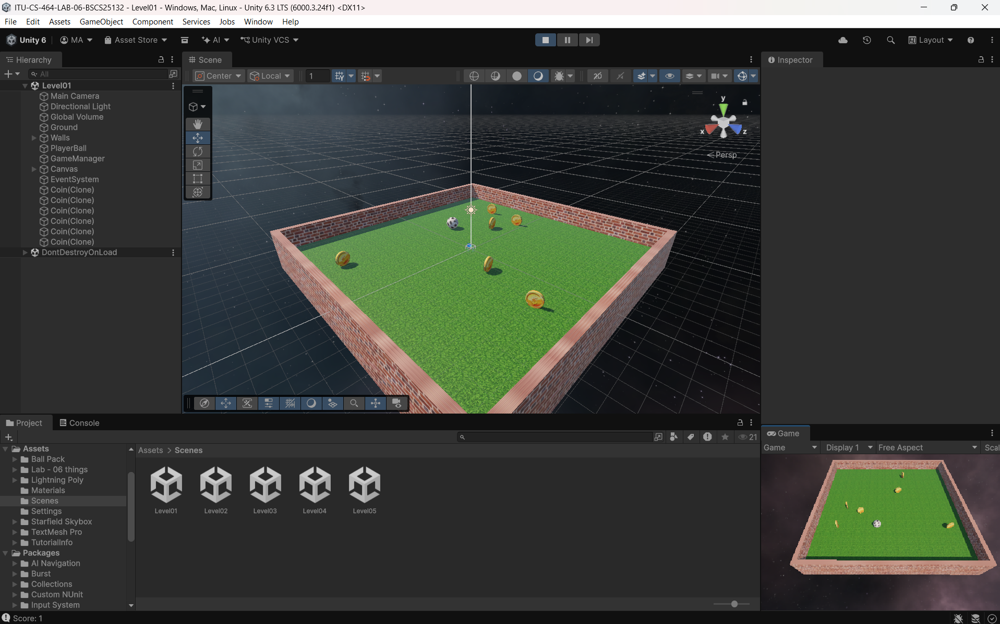
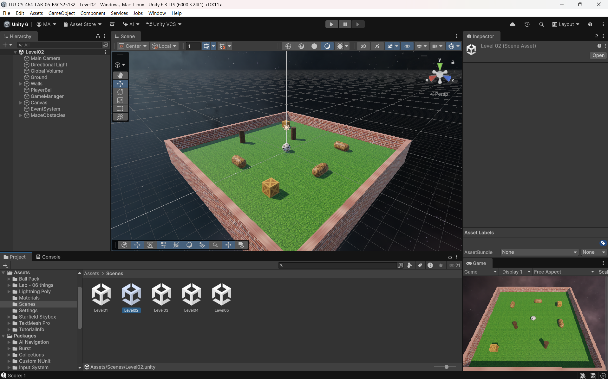
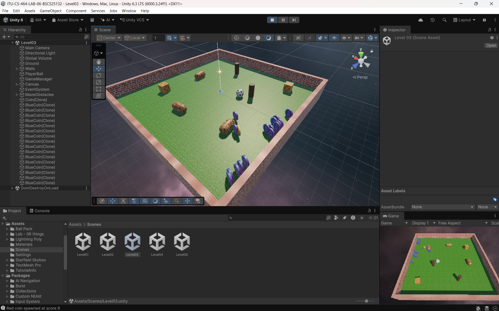
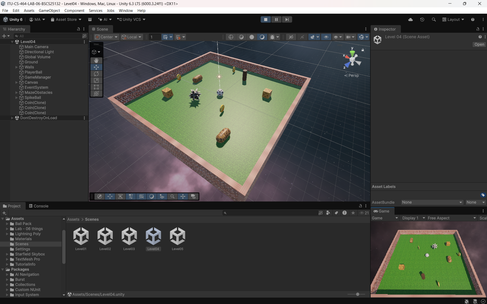
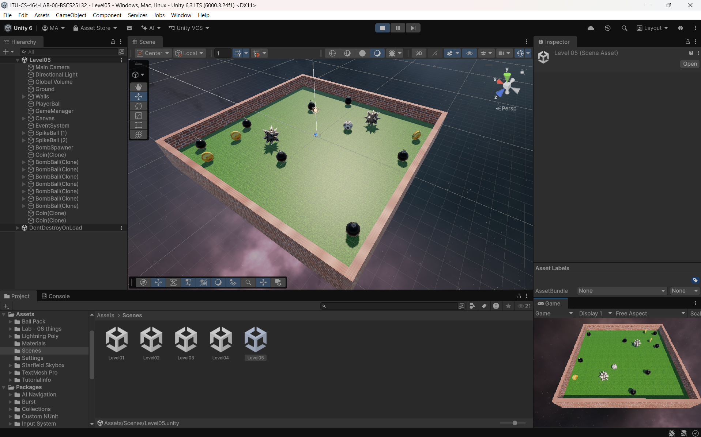

# ITU-CS-464-LAB-06-BSCS25132

# Coin Collector Ball Game (5 Levels)

**Student Name:** Muhammad Abdullah (BSCS-25132)
**Course:** CS-464 Game Development, ITU | **Lab:** 06

A 3D Unity game where you roll a ball, collect coins and survive dangers. In this lab, the game from Lab 05 is extended into 5 levels. Each level has its own layout and objective, and the difficulty goes up from Level 1 to Level 5.

## Game Idea
Finish every level by collecting the coins before the timer ends. When a level ends, a panel shows your score. If you win, you can go to the Next Level. If you lose, you can Restart. After Level 5, the game goes back to Level 1.

## Levels

**Level 1: Easy Start**
Just collect the gold coins. There is no bonus and no danger, and the timer is relaxed. This level is to learn the controls.

**Level 1**

**Level 2: Maze Run**
Obstacles are added to the level, so the ball has to move around them. The timer is shorter.

**Level 2**

**Level 3: Bonus Coins**
This is the main game from Lab 05. A special Red Coin appears once. Collecting it spawns Blue Bonus Coins around the player, and a hidden bonus counter shows up.

**Level 3**

**Level 4: Run!**
Enemy balls now chase the player. If one touches you, the game is over. Use the obstacles to escape while collecting coins.

**Level 4**

**Level 5: Final Maze**
The hardest level. Fast enemy balls chase you, and bombs appear one by one in the maze. Touching a bomb ends the game with a blast sound. The timer is the shortest.

**Level 5**

## Features
- Coins spawn automatically, one by one, at random places (never inside obstacles)
- Live score and countdown timer
- Level name shown at the top of every level
- Next Level and Restart buttons on the end panel
- Chasing enemies and bombs as dangers
- Different sounds for coins, the red coin and the bomb blast
- Textures on coins and ball
- Smooth camera that follows the ball

## Links
- Gameplay Video Drive Link: https://drive.google.com/file/d/1sDvtHlwH8_rtR2JhcSBae81sXdaQeJdg/view?usp=sharing 
- Repo: https://github.com/MAbdullah-BSCS25132/ITU-CS-464-LAB-06-BSCS25132

## Made With
Unity, C#